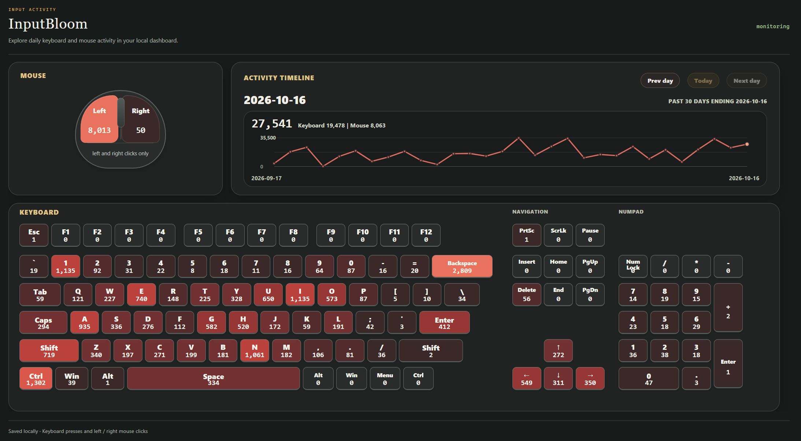

# InputBloom

**InputBloom** is a lightweight Python keyboard and mouse heatmap for Windows.

<div align="center">
  
  <p>
    <sub>
      <em>Figure 1. System Snapshot</em>
    </sub>
  </p>
</div>

## Requirements

- Windows 11
- Python 3.10 or newer

## Usage

1. Install [Python 3](https://www.python.org/downloads/windows/) and add it to PATH.
2. Download this project, then open **Windows PowerShell** and run:

   ```powershell
   cd path\to\InputBloom
   python3 -B app.py
   ```

3. The dashboard opens in your browser and starts tracking automatically.
4. Press **Enter** or **Ctrl+C** in the terminal to save and stop.

## Features

- Tracks daily keyboard presses and left/right mouse clicks
- Displays a live keyboard and mouse heatmap
- Shows a recent 30-day activity timeline
- Saves daily counts locally in `keyboard_mouse_daily_log.ini`
